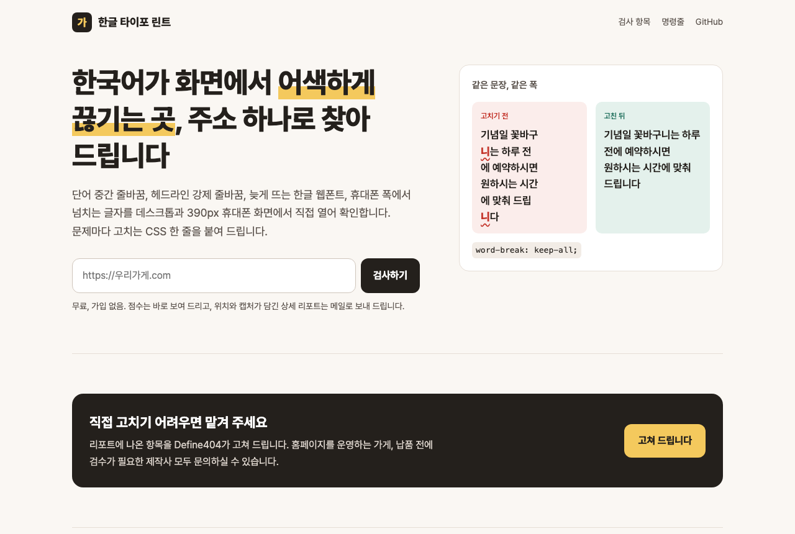

# 한글 타이포 린트 (hangul-type-lint)

[Define404]

바로 써 보기: https://type.define404.com



홈페이지 주소나 HTML 파일을 넣으면, 한국어가 화면에서 어색하게 보이는 곳을 찾고 고치는 CSS 한 줄을 붙여 주는 검사기입니다.

- 데스크톱 1280px와 휴대폰 390px 두 화면으로 실제 페이지를 열어 봅니다
- 문제마다 위치(선택자), 해당 글, 왜 문제인지 한 줄, 고치는 CSS 한 줄, 위치를 표시한 화면 캡처를 남깁니다
- 심각한 문제가 있으면 종료 코드 1을 내므로 배포 전 자동 검사(CI)에 넣을 수 있습니다
- 오픈소스(MIT)라 누구나 무료로 쓰고 고칠 수 있습니다

상태: v0.1. 명령줄은 시험을 마쳤고, 무료 웹판은 https://type.define404.com 에서 실제 검사(Browser Rendering)로 돌아갑니다. 아래 "시험한 범위"를 봐 주세요.

## 무엇을 찾나

| 항목 | 단계 | 판단 기준 | 고치는 줄 (예) |
|---|---|---|---|
| 단어 중간 줄바꿈 | 헤드라인 심각, 본문 보통 | `word-break: keep-all`이 없고, 줄이 바뀌는 자리의 앞뒤 글자가 둘 다 한글 | `word-break: keep-all;` |
| 헤드라인 강제 줄바꿈 | 보통 | h1~h3, 28px 이상 글자 안의 `<br>` (앞뒤에 글이 있을 때) | `max-width: 18em;` |
| 한글 폰트 로딩 중 글자 숨김 | 보통 | 한글 웹폰트의 `font-display`가 없거나(auto) block | `font-display: swap;` |
| 한글 폰트 불러오기 실패 | 보통 | `@font-face` 파일을 받지 못함 | 경로 수정 |
| 큰 한글 폰트 파일 | 보통 | 300KB가 넘는 폰트 파일. 파일 이름과 크기를 적음 | 글자 범위로 나눈 서브셋 파일 |
| 한글·영문 서체 짝 불일치 | 보통 | 영문은 웹폰트, 한글은 기기 기본 서체로 그려짐 (Chrome 개발자 도구 프로토콜로 실제 쓰인 글꼴 확인) | `font-family: "Inter", "Pretendard", sans-serif;` |
| 너무 긴 줄 | 낮음 | 데스크톱에서 한 줄 평균 45자 초과 | `max-width: 38em;` |
| 너무 좁은 자간 | 낮음 | 20px 이하 본문 자간이 -0.03em보다 좁음 | `letter-spacing: -0.01em;` |
| 작은 본문 글자 | 보통 | 휴대폰에서 한글 20자 이상 글이 14px 미만 | `font-size: 15px;` |
| 휴대폰 화면 설정 없음 | 심각 | `<meta name="viewport">` 없음 | viewport 태그 추가 |
| 390px 가로 넘침 | 심각 | 휴대폰 폭에서 화면 밖으로 나가는 요소 | 원인에 따라 `min-width: 0;`, `max-width: 100%;`, `white-space: normal;` 등 |
| 잘린 한글 | 보통 | 말줄임표, 줄 수 제한, nowrap 숨김으로 한글 문장이 잘림 | `white-space: normal; text-overflow: clip;` |

점수는 100점에서 심각 15점, 보통 6점, 낮음 2점씩 뺍니다. 같은 문제가 여러 곳이면 한 줄로 묶고 개수를 적습니다.

## 명령줄

Node.js 20 이상이 필요합니다.

```bash
git clone https://github.com/johndefine404/hangul-type-lint.git
cd hangul-type-lint
npm install
npx playwright install chromium        # 처음 한 번
npm test                               # 시험용 두 페이지로 확인
node bin/hangul-type-lint.mjs check https://example.com
node bin/hangul-type-lint.mjs check ./dist/index.html --fail-on medium
```

npm에 올린 뒤에는 `npx hangul-type-lint check <주소>`로 씁니다 (아직 올리지 않았습니다).

| 옵션 | 내용 |
|---|---|
| `--out <폴더>` | 리포트 저장 폴더. 기본 `./htl-report` (report.html, report.json, shots/) |
| `--json` | 결과를 JSON으로만 출력 |
| `--no-shots` | 화면 캡처를 만들지 않음 |
| `--fail-on <단계>` | 이 단계 이상이 하나라도 있으면 종료 코드 1. `high`(기본), `medium`, `none` |

종료 코드: 0 통과, 1 기준 이상 문제 발견, 2 실행 오류.

배포 전 검사 예 (GitHub Actions):

```yaml
- run: npx playwright install --with-deps chromium
- run: node bin/hangul-type-lint.mjs check ./dist/index.html
```

알아 둘 점:

- 검사하는 컴퓨터에 한글 폰트가 설치돼 있으면 처음 온 손님이 받는 폰트 크기를 잴 수 없어서, 외부 스타일시트의 `local()` 지정을 빼고 엽니다. `<style>` 태그 안의 `local()`은 그대로 둡니다
- 한글·영문 서체 짝은 검사하는 기기의 기본 서체 기준입니다. 맥과 윈도·안드로이드에서 한글 기본 서체가 다릅니다
- 단어 중간 줄바꿈은 글자 위치를 하나씩 재서 판단하므로 아주 긴 페이지는 앞부분 일부(약 12만 자)만 봅니다

## 무료 웹판 (Cloudflare)

주소를 넣으면 점수와 문제 종류를 화면에 보여 주고, 위치·고치는 CSS·캡처가 담긴 상세 리포트는 메일로 보냅니다. 메일 신청에는 개인정보 수집·이용 동의(필수)를 받고, 광고성 정보 수신 동의(선택)는 따로 받습니다. 자세한 기준은 아래 "개인정보와 광고 수신"에 있습니다. 리드(신청자)는 D1에 쌓이고, 운영자에게 메일로 알립니다. 메일은 Gmail API(Google Workspace)를 먼저 쓰고, 그 설정이 없으면 Resend, 둘 다 없으면 콘솔에만 찍습니다.

```
브라우저 ─> Worker (Hono) ─> Browser Rendering: 실제 페이지 검사 (MOCK = "1" 이면 예시 결과)
                │
                ├─> D1: 검사 결과, 리포트 신청(동의 시각 포함), 하루 사용량
                └─> Gmail API 또는 Resend: 상세 리포트 메일, 동의 처리 알림, 운영자 알림
```

| 보호 장치 | 기본값 |
|---|---|
| 하루 검사 상한 `DAILY_LIMIT` | 50회 (Browser Rendering 무료 한도 보호) |
| 하루 리포트 메일 상한 `DAILY_MAIL_LIMIT` | 100통 |
| 접속자별 요청 제한 | 1분에 10번 |
| 내부망 주소 거절 | localhost, 사설 IP |
| 다른 사이트에서 보낸 쓰기 요청 | 거절 (같은 주소와 `ALLOWED_ORIGINS`만 받음) |

로컬 실행 (MOCK 모드, 원격 호출 없음):

```bash
cd web
npm install
npx wrangler types                     # 타입 파일(worker-configuration.d.ts) 만들기
npm run check                          # 타입 검사
npm test                               # 메일 원문(MIME) 만들기 시험
npx wrangler d1 migrations apply DB --local
npx wrangler dev
```

배포:

```bash
npx wrangler d1 create hangul-type-lint      # 받은 database_id 를 wrangler.toml 에 넣는다
npx wrangler d1 migrations apply DB --remote
# 메일: 아래 "메일 설정" 중 하나
npx wrangler secret put OWNER_EMAIL          # 운영자 알림을 받을 주소 (선택)
# wrangler.toml 의 MOCK 을 "0" 으로, MAIL_FROM 을 보내는 주소로 바꾼다
npx wrangler deploy
```

운영 값(D1 id, 도메인, MOCK 끄기)은 저장소에 올리지 않는 `web/wrangler.prod.toml`에 따로 두고 `--config wrangler.prod.toml`로 쓰는 것을 권합니다.

### 메일 설정

`GMAIL_CLIENT_ID`, `GMAIL_CLIENT_SECRET`, `GMAIL_REFRESH_TOKEN` 셋이 모두 있으면 Gmail API로 보냅니다. 없고 `RESEND_API_KEY`가 있으면 Resend로 보냅니다. 둘 다 없으면 콘솔에만 남깁니다.

Gmail API (Google Workspace 계정으로 보내기):

1. Google Cloud 콘솔에서 프로젝트를 만들고 Gmail API를 켭니다
2. OAuth 동의 화면을 만듭니다. Workspace 계정이면 "내부"로 두면 검수 없이 쓸 수 있습니다
3. 사용자 인증 정보에서 OAuth 클라이언트 ID를 "데스크톱 앱"으로 만듭니다. 클라이언트 ID와 비밀번호가 나옵니다
4. 보내는 계정으로 로그인해 `https://www.googleapis.com/auth/gmail.send` 범위 하나만 승인받고 refresh token을 받습니다. 예: OAuth 2.0 Playground에서 오른쪽 위 설정에 내 클라이언트 ID·비밀번호를 넣고, 범위에 위 주소를 적어 승인한 뒤 "Exchange authorization code for tokens"
5. 세 값을 Worker 비밀값으로 넣습니다. 화면이나 파일에 남지 않게 표준 입력으로 넘깁니다

```bash
npx wrangler secret put GMAIL_CLIENT_ID
npx wrangler secret put GMAIL_CLIENT_SECRET
npx wrangler secret put GMAIL_REFRESH_TOKEN
```

`MAIL_FROM`의 주소는 refresh token을 받은 계정 주소(또는 그 계정에 등록된 보내는 주소)여야 합니다. 표시 이름은 한글도 됩니다 (예: `한글 타이포 린트 <you@example.com>`). Worker는 refresh token으로 액세스 토큰을 받아 만료 전까지 메모리에 두고, 메일 원문(MIME)을 직접 만들어 `users/me/messages/send`로 보냅니다.

Resend: `npx wrangler secret put RESEND_API_KEY`. `MAIL_FROM`은 Resend에서 확인한 도메인 주소여야 합니다.

Browser Rendering의 무료 한도와 플랜 조건은 아직 확인하지 않았습니다. 배포 전에 Cloudflare 문서에서 확인하고 `DAILY_LIMIT`을 맞춥니다.

## 개인정보와 광고 수신

웹판이 받는 정보와 처리 기준입니다. 법률 자문이 아닌 운영 기준입니다. 명령줄은 아무 정보도 보내지 않습니다.

| 구분 | 필수 동의 (리포트 받기) | 선택 동의 (광고 수신) |
|---|---|---|
| 목적 | 상세 리포트 발송, 리포트 문의 답변 | Define404 서비스 안내, 새 무료 도구 소식 |
| 항목 | 메일 주소, 검사한 홈페이지 주소, 동의 시각 | 메일 주소, 동의 시각 |
| 기간 | 수집일로부터 1년, 매일 자동 삭제 (요청 시 즉시 삭제) | 동의일로부터 2년 또는 수신 거부 때까지 |
| 거부하면 | 상세 리포트를 메일로 받을 수 없음 (화면 점수는 그대로) | 아무 불이익 없음, 리포트도 똑같이 받음 |

- 동의 항목은 따로 나누고, 광고 수신 체크는 처음에 꺼져 있습니다 (개인정보 보호법 제15조 제2항, 제22조 제1항·제5항)
- 서비스 안내(광고)는 광고 수신에 동의한 분의 리포트 메일에만 넣고, 제목 앞에 "(광고)"를 붙이고, 보낸 곳(Define404)과 연락처(https://contact.define404.com), 한 번 누르면 되는 수신 거부 링크를 적습니다 (정보통신망법 제50조 제1항·제4항)
- 한국 시간 21:00~08:00에는 광고를 넣지 않습니다. 야간 동의는 따로 받지 않습니다 (제50조 제3항)
- 수신 거부는 링크 한 번(메일 앱의 한 번 누름 수신 거부 포함)이고 비용이 들지 않으며, 거부한 주소에는 광고를 보내지 않습니다 (제50조 제2항·제5항·제6항)
- 동의, 수신 거부, 2년 만료 때마다 처리 결과를 메일로 알립니다. 메일 설정이 없으면 서버 기록에 남깁니다 (제50조 제7항)
- 2년마다 다시 묻는 대신, 동의일로부터 2년이 지나면 동의를 끝내고 알립니다. 매일 01:00 UTC(한국 10:00) 예약 작업이 처리합니다 (제50조 제8항)
- 이름은 받지 않습니다. 화면 캡처는 리포트를 보낸 뒤 지웁니다
- 서버 운영·저장은 Cloudflare, Inc.(미국), 메일 발송은 Google LLC(미국)에 맡깁니다. 화면의 동의 문구와 바닥글에 개인정보 처리방침 링크(`PRIVACY_URL`, 기본 https://contact.define404.com/privacy.html)를 둡니다

## 시험한 범위

| 부분 | 상태 |
|---|---|
| 명령줄: 나쁜 예시 `fixtures/bad.html` | 11개 발견, 종료 코드 1 (`npm test`) |
| 명령줄: 좋은 예시 `fixtures/good.html` | 0개, 종료 코드 0 (`npm test`) |
| 명령줄: 공개 사이트 | https://booking.define404.com 검사 완료 |
| 웹판 화면, 검사 요청, 리포트 신청, 동의 검사, 요청 제한 | wrangler dev + MOCK 모드에서 확인. 운영 주소에서 동의 없는 신청 400, 다른 출처 쓰기 403, 없는 주소 404 확인 |
| 웹판 화면이 이 검사기를 통과하는지 | 통과 (100점), 1280px·390px 가로 넘침 0 |
| 웹판 실제 검사 (Browser Rendering) | 운영 주소에서 https://contact.define404.com 검사 성공 (약 7초, 문제 0개) |
| 리포트 메일 발송 (Gmail API) | 운영 주소에서 실제 발송·수신 확인 (광고 없는 리포트, 운영자 알림 포함). 메일 원문 만들기는 `cd web && npm test` |
| 캡처 첨부 메일, Resend 경로 | 시험 안 함 (운영 시험 사이트에 문제가 없어 캡처가 생기지 않았음) |
| 동의 처리 알림, 수신 거부 링크, 매일 삭제·만료 작업 | wrangler dev + MOCK 모드에서 확인 (메일은 콘솔 출력). 낮 시간 광고 포함 메일은 시험 안 함 |
| 웹판에서 서체 짝 실제 확인, 폰트 크기 | 웹판은 추정 방식만 씁니다. 폰트 크기는 응답 헤더 기준이라 빠질 수 있습니다 |

## 직접 고치기 어려우면

리포트에 나온 항목을 Define404가 고쳐 드립니다. https://contact.define404.com

## English

hangul-type-lint finds places where Korean text renders awkwardly on a web page and suggests a one-line CSS fix for each. It opens the page at 1280px and 390px with Playwright and checks mid-word line breaks (missing `word-break: keep-all`), forced `<br>` in headlines, Korean web font loading (`font-display`, failed loads, font files over 300KB), Korean/Latin font pairing (verified with the Chrome DevTools Protocol), line length over ~45 Korean characters, tight letter-spacing, small body text on mobile, horizontal overflow and clipped Korean text at 390px. Each finding has a selector, sample text, a one-line reason, a one-line fix and a highlighted screenshot. The CLI writes `report.html` and exits with code 1 when high-severity issues are found, so it can run in CI. A free web version runs on Cloudflare Workers with Browser Rendering and D1; it was only tested locally in mock mode. MIT licensed.
